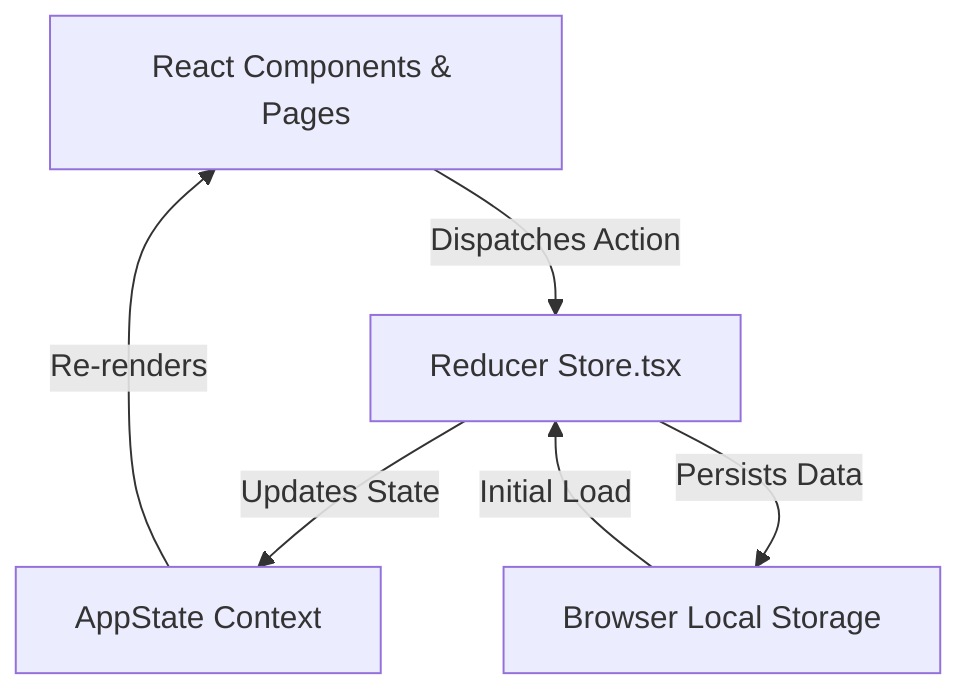

# DevSync — Enterprise Architecture & Product Overview

DevSync is a high-fidelity, client-centric student collaboration and team-matching ecosystem. It is engineered to empower technical builders to form balanced teams, display real-time contribution heatmaps, manage projects, and apply to roles with custom resume uploads.

---

## 1. Executive Summary & Value Proposition

In academic and developer communities, team formation and showcasing project progression is highly fragmented. DevSync addresses this with:
- **Smart Team Matching**: Bridges developer profiles (Skills, Roles) with active project vacancies.
- **Dynamic Portfolios**: Integrates contribution heatmaps, project workspaces, and connected builder lists.
- **Unified State Framework**: Provides a cohesive, local-first state system, simulating backend data cascades on the client side.

---

## 2. Product Capabilities & User Flows

### A. Dynamic 3D WebGL Networks
- **Visual Visualizer**: Renders interactive theme-aware network node structures (representing builder connections) on both the Landing Page ([Hero3D.tsx](file:///Users/anshgupta/Documents/GitHub/devsync-connect/src/components/Hero3D.tsx)) and the Profile Page ([ProfileHero3D.tsx](file:///Users/anshgupta/Documents/GitHub/devsync-connect/src/components/ProfileHero3D.tsx)).
- **Theme Adaptation**: Nodes and wireframe meshes dynamically adjust colors and light properties. In dark mode, nodes show a vibrant red glow (`#dc2626`) and white wireframe meshes (`#ffffff` at `0.36` opacity). In light mode, they transition to a deep blue glow (`#1e40af`) and dark wireframe meshes (`#000000` at `0.22` opacity) to ensure maximum contrast and premium aesthetics.

### B. Wizard Onboarding Flow ([Onboarding.tsx](file:///Users/anshgupta/Documents/GitHub/devsync-connect/src/pages/Onboarding.tsx))
- **Step-by-Step Profile Creation**: Guides users through basic details, matching interests, and college affiliations.
- **Smart Skills Selector**: Features popular recommended skills clickable tags and supports custom tag creation, complete with inputs validation.
- **Bio Validation**: Requires a comprehensive bio statement to ensure complete and realistic profiles, binding validation errors directly to the input fields.

### C. Builder Directory ([DiscoverBuilders.tsx](file:///Users/anshgupta/Documents/GitHub/devsync-connect/src/pages/DiscoverBuilders.tsx))
- **Priority-Relevance Search**: Renders a list of builders sorted dynamically. When search terms are active, it calculates query-relevance scores based on prefix, exact matches, and domain keywords (Name matches = +100, Prefix = +60, Substring = +30, Skill match = +15 to +40, Domain match = +10 to +20).
- **Interactive Profiles**: Clicking a builder’s avatar/details navigates directly to their profile.
- **Instant Search Syncing**: Typing in the global search bar instantly filters results and updates URL parameters without losing input focus.

### D. Projects & Workspace Directory ([FindProjects.tsx](file:///Users/anshgupta/Documents/GitHub/devsync-connect/src/pages/FindProjects.tsx))
- **Recommended Sorting**: Projects are ranked dynamically based on tech-stack alignment with the logged-in user's profile skills.
- **My Projects Management ([MyProjects.tsx](file:///Users/anshgupta/Documents/GitHub/devsync-connect/src/pages/MyProjects.tsx))**:
  - Displays user-owned projects, member tracking metrics, and development progress sliders (0–100%).
  - **Inline Visibility Dropdown**: Owners can change project visibility (Public, Friends, Private) via an inline dropdown directly on the project card.
  - **Edit Project Details ([EditProjectModal.tsx](file:///Users/anshgupta/Documents/GitHub/devsync-connect/src/components/EditProjectModal.tsx))**: An overlay form allowing owners to edit title, description, team, progress, status, and members limit.
  - **Project Workspaces**: Links to detail pages ([ProjectDetail.tsx](file:///Users/anshgupta/Documents/GitHub/devsync-connect/src/pages/ProjectDetail.tsx)) that show milestones, project summaries, and discussion feeds.

### E. Role Application & Resume Pipeline
- **Apply to Roles ([ApplyRoleModal.tsx](file:///Users/anshgupta/Documents/GitHub/devsync-connect/src/components/ApplyRoleModal.tsx))**: When users click "Apply" on required roles, the system opens a dialog modal.
  - Requires a cover letter note and relevant skills list.
  - Requires a resume document upload (PDF, Word, or Images under 2MB limit), parsed dynamically as a base64 Data URI.
- **Inbox Review Dashboard ([Requests.tsx](file:///Users/anshgupta/Documents/GitHub/devsync-connect/src/pages/Requests.tsx))**: Project owners receive applications in their Inbox tab.
  - Displays cover note, listed skills, and a clickable **"View Resume"** link to download or view the file.
  - **Auto-Join on Acceptance**: Accepting the application request immediately adds the user to the project and increments the member counts in the global store.

### F. Contribution Graph ([Profile.tsx](file:///Users/anshgupta/Documents/GitHub/devsync-connect/src/pages/Profile.tsx))
- **Activity Heatmap**: Renders a complete 53x7 GitHub-style activity contribution graph representing the user's progress.
- **Theme-Aware Themes**: Heatmap colors dynamically adjust using official GitHub palettes for dark and light modes.
- **Seeded Generator**: Deterministically generates stable contribution history based on the builder's profile name.

### G. Recent Enhancements & UI/UX Fixes
- **Dynamic Stat Cards**: The Home Page features dynamic counters for Active Projects and Working Projects, updating in real-time. Cards are now clickable—"Active Projects" routes to `/find-projects` and "My Team" handles smart routing.
- **Smart Login Modal**: Unauthenticated users clicking "My Team" are presented with a sleek, animated "Login Required" modal overlay guiding them to login or signup, rather than abrupt page redirects.
- **Project Image Rendering**: Fixed image upload persistence. Media uploaded during project creation is now beautifully rendered with dynamic max-height cover styling across the Feed, `MyProjects.tsx` dashboard, and `ProjectDetail.tsx` overview.

---

## 3. Codebase Architecture & Directory Map

The DevSync workspace is structured to facilitate scalable, component-based frontend engineering:

```
devsync-connect/
├── public/                 # Static asset folders
├── src/
│   ├── components/         # Reusable presentation blocks
│   │   ├── ui/             # Radix & Shadcn tailwind building primitives
│   │   ├── ApplyRoleModal.tsx   # Modal for role cover letters & resume uploads
│   │   ├── AvatarUpload.tsx     # Base64 photo upload encoder
│   │   ├── CreatePostModal.tsx  # Add custom collaboration recruitment posts
│   │   ├── EditProjectModal.tsx # Project description & progress updates modal
│   │   ├── ErrorBoundary.tsx    # Catch UI render crashes gracefully
│   │   ├── Feed.tsx             # List and filters for recruitment posts
│   │   ├── Hero3D.tsx           # Home WebGL 3D network animation
│   │   ├── Layout.tsx           # App grid structure shell (Navbar, Footer, Outlet)
│   │   └── ProfileHero3D.tsx    # Profile page WebGL 3D network animation
│   ├── data/
│   │   └── mock.ts         # Seed datasets for users and teams
│   ├── hooks/
│   │   ├── use-mobile.tsx  # Mobile view state query hook
│   │   └── use-toast.ts    # Notification alerts trigger hook
│   ├── lib/
│   │   ├── store.tsx       # State Provider, Reducers, Actions, local storage sync
│   │   ├── types.ts        # Fully documented type definitions
│   │   └── utils.ts        # Tailwind merging and class string construction
│   ├── pages/              # Primary routing layout blocks
│   │   ├── Dashboard.tsx        # Overview analytics dashboard
│   │   ├── DiscoverBuilders.tsx # Search and filter builders index
│   │   ├── FindProjects.tsx     # Find projects matching user skills
│   │   ├── Index.tsx            # Main Landing Home Page
│   │   ├── Login.tsx            # Account credential authorization
│   │   ├── MyProjects.tsx       # Owned projects edit dashboard
│   │   ├── Onboarding.tsx       # Onboarding questionnaire wizard
│   │   ├── Profile.tsx          # Portfolios, contributions heatmap, details
│   │   ├── ProjectDetail.tsx    # Goals, milestones, roles, discussions
│   │   ├── Requests.tsx         # Inbox requests, accept actions, resume downloads
│   │   └── Settings.tsx         # Manage profile and preferences
│   ├── App.tsx             # Route registry and Providers container
│   ├── index.css           # Global theme variables, animations, custom selectors
│   └── main.tsx            # Entrypoint compiler script
├── package.json            # Scripts and dependency versions
├── tailwind.config.ts      # CSS color variable bindings
└── vite.config.ts          # Build bundle setup config
```

---

## 4. Client-Side State Management ([store.tsx](file:///Users/anshgupta/Documents/GitHub/devsync-connect/src/lib/store.tsx))

The frontend mimics a relational database server using standard React Context (`AppProvider`) and a root `reducer` switch:



### Action Types & Logic
1. **`setCurrentUser`**: Updates the logged-in session user and caches their profile in the user dictionary.
2. **`createPost`**: Adds a new recruit post and spawns an associated Project Workspace tracking members and progress metrics.
3. **`follow` / `unfollow`**: Appends or removes builder IDs in following/followers vectors.
4. **`sendRequest`**: Submits collaboration requests, attaching base64 resumes, cover notes, and custom skills tag arrays.
5. **`updateRequest`**: Accepts or declines requests. On acceptance:
   - Sets follower connections between the builders.
   - Automatically increments the project's member counts in real-time.
6. **`deleteProject`**: Deletes a project workspace and triggers a cascade deletion to wipe the associated recruitment feed posts.
7. **`updateProject`**: Commits title, status, description, visibility, and progress updates.

---

## 5. Styling Tokens & Custom Classes ([index.css](file:///Users/anshgupta/Documents/GitHub/devsync-connect/src/index.css))

DevSync utilizes HSL variables mapped dynamically by `next-themes` to support smooth transitions:

```css
/* Core Styling Variables Example */
--primary: 221 83% 53%;         /* Sleek Indigo Primary */
--success: 142 71% 38%;         /* Emerald Success */
--gradient-primary: linear-gradient(135deg, hsl(221 83% 53%), hsl(262 83% 58%));
```

### Custom Utility Class Definitions
- **`.ds-card`**: Sleek card containers with radius boundaries, subtle shadow elevations, and accent styling.
- **`.glass-panel`**: Semitransparent background paneling incorporating `backdrop-filter: blur(12px)`.
- **`.ds-input`**: Standard input textareas styling, tracking focus ring transitions.
- **`.ds-chip-primary`**: Accent pill tags styling matching skill sets.

---

## 6. Build, Test, & Execution Guide

### Commands
- **Install Dependencies**: `npm install`
- **Start Development Server**: `npm run dev`
- **Build Production Bundle**: `npm run build`
- **Preview Production Build**: `npm run preview`
- **Run Unit Tests**: `npm run test`
- **Run ESLint Linter**: `npm run lint`

---

## 7. Enterprise Production Backend Roadmap

To shift DevSync from client-side state persistence to a robust cloud infrastructure, the following architectural steps are recommended:

### A. Database Design (PostgreSQL Schema)

```sql
-- Users Table
CREATE TABLE users (
    id UUID PRIMARY KEY DEFAULT gen_random_uuid(),
    name VARCHAR(100) NOT NULL,
    email VARCHAR(255) UNIQUE NOT NULL,
    password_hash VARCHAR(255) NOT NULL,
    username VARCHAR(50) UNIQUE,
    handle VARCHAR(50),
    avatar_url TEXT,
    bio TEXT,
    college VARCHAR(150),
    skills TEXT[] DEFAULT '{}',
    roles TEXT[] DEFAULT '{}',
    domains TEXT[] DEFAULT '{}',
    github_link TEXT,
    linkedin_link TEXT,
    portfolio_link TEXT,
    followers_ids UUID[] DEFAULT '{}',
    following_ids UUID[] DEFAULT '{}',
    created_at TIMESTAMP WITH TIME ZONE DEFAULT CURRENT_TIMESTAMP
);

-- Projects Table
CREATE TABLE projects (
    id UUID PRIMARY KEY DEFAULT gen_random_uuid(),
    title VARCHAR(150) NOT NULL,
    description TEXT,
    owner_id UUID NOT NULL REFERENCES users(id) ON DELETE CASCADE,
    team_name VARCHAR(150),
    tech TEXT[] DEFAULT '{}',
    roles TEXT[] DEFAULT '{}',
    members INT DEFAULT 1,
    max_members INT DEFAULT 4,
    progress INT DEFAULT 0,
    status VARCHAR(50) DEFAULT 'Recruiting',
    category VARCHAR(50) DEFAULT 'Web',
    visibility VARCHAR(20) DEFAULT 'public',
    created_at TIMESTAMP WITH TIME ZONE DEFAULT CURRENT_TIMESTAMP
);

-- Posts / Feed Table
CREATE TABLE posts (
    id UUID PRIMARY KEY DEFAULT gen_random_uuid(),
    author_id UUID NOT NULL REFERENCES users(id) ON DELETE CASCADE,
    title VARCHAR(150) NOT NULL,
    body TEXT NOT NULL,
    type VARCHAR(50) NOT NULL,
    project_name VARCHAR(150),
    domain TEXT[],
    tech TEXT[],
    project_type VARCHAR(50),
    looking_for TEXT[],
    image_url TEXT,
    visibility VARCHAR(20) DEFAULT 'public',
    status VARCHAR(20) DEFAULT 'open',
    created_at TIMESTAMP WITH TIME ZONE DEFAULT CURRENT_TIMESTAMP
);

-- Collaboration Requests Table
CREATE TABLE requests (
    id UUID PRIMARY KEY DEFAULT gen_random_uuid(),
    from_id UUID NOT NULL REFERENCES users(id) ON DELETE CASCADE,
    to_id UUID NOT NULL REFERENCES users(id) ON DELETE CASCADE,
    project_id UUID REFERENCES projects(id) ON DELETE CASCADE,
    message TEXT,
    role VARCHAR(100),
    resume_url TEXT NOT NULL,
    resume_name VARCHAR(255),
    skills TEXT[] DEFAULT '{}',
    status VARCHAR(20) DEFAULT 'pending',
    created_at TIMESTAMP WITH TIME ZONE DEFAULT CURRENT_TIMESTAMP
);
```

### B. Media & Document Upload Pipeline
1. **Frontend**: Request pre-signed S3 upload URLs from API Gateway.
2. **Object Storage**: Direct client upload of files/PDFs to secure AWS S3 bucket.
3. **Database Registry**: Frontend submits metadata (Cover note, skills list, S3 URL link) to the backend API endpoint.

### C. REST API Hooks
Replace local context dispatches in [store.tsx](file:///Users/anshgupta/Documents/GitHub/devsync-connect/src/lib/store.tsx) with React Query/TanStack Query mutation functions pointing to:
- `POST /api/auth/login` (Credential check returning JWT tokens)
- `POST /api/requests` (Create new member requests)
- `PATCH /api/requests/:id` (Accept/decline application; handles atomic member increments in transactions)
- `DELETE /api/projects/:id` (Trigger cascade project deletion logs)

---

## 8. React Doctor Audit & Recent Bug Fixes

Recently, the codebase underwent an extensive audit using `react-doctor`, which flagged several architectural, security, and performance concerns. The following remediation steps were taken:

### 1. Security & Cross-Site Scripting (XSS) Prevention
- **Bug:** The application previously used React's `dangerouslySetInnerHTML` to render user-supplied post content and chart tooltips. This opened the application to potential XSS attacks where malicious users could inject executable JavaScript.
- **Fix (DOMPurify):** We integrated **DOMPurify**, a DOM-only, super-fast, uber-tolerant XSS sanitizer for HTML. DOMPurify strips out dangerous HTML tags and JavaScript payload attributes (like `onload` or `onerror`) before they are rendered to the DOM. This allows us to safely render rich text without exposing users to malicious scripts.

### 2. Performance: Lazy Loading Heavy Libraries
- **Bug:** `recharts`, a heavy data visualization library, was being eagerly imported at the top of several pages (`Profile.tsx` and `TeamDetail.tsx`), blocking the initial page render and bloating the JavaScript bundle size.
- **Fix:** We abstracted the charts into separate components (`ProfileChart.tsx` and `TeamChart.tsx`) and utilized React's `lazy` and `Suspense` APIs to dynamically load them only when needed. This significantly improves the application's load speed.

### 3. React Core Warnings (Hooks & Keys)
- **Bug:** Numerous `useEffect` and `useMemo` hooks were missing critical dependencies, leading to potential stale closures. Additionally, list iterators were using arbitrary array indices (`key={i}`) which corrupts React's DOM reconciliation.
- **Fix:** We meticulously tracked all missing dependencies (like `dispatch` and `state.currentUser`) and replaced index-based keys with deterministic entity properties (e.g., `key={project.id}`).

### 4. Navigation & Runtime Crashes
- **Bug:** The `MyProjects` page crashed with a `TypeError: Cannot read properties of undefined (reading 'toLowerCase')` if a user's name was missing during load states. Additionally, clicking "Start a Project" corrupted React Router's internal history state by using the native `window.history.replaceState`.
- **Fix:** Implemented optional chaining (`?.toLowerCase()`) to prevent immediate crashes and replaced native history mutation with React Router's `navigate(..., { replace: true })` to preserve back-button functionality.

### 5. New Components & Dynamic Cards
- **Created Chart Components:** To resolve the performance bottleneck, we created two entirely new components: `ProfileChart.tsx` and `TeamChart.tsx`. These encapsulate the heavy data visualization logic so they can be loaded independently.
- **Interactive Project Cards:** The Project Cards displayed on the `MyProjects` dashboard were updated to be highly interactive. You can now change a project's visibility (Public, Friends, Private) directly via an inline dropdown right on the card itself.
